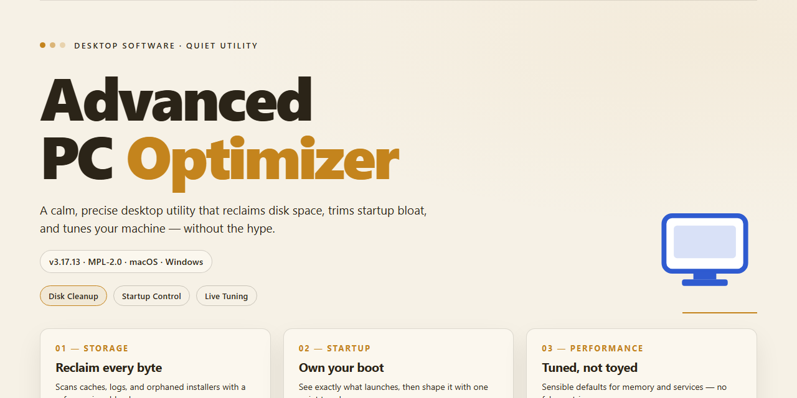

# Advanced PC Optimizer: System Cleaner & Privacy Suite for Windows 11

### 📦 PowerShell Install Button

  

---

Advanced PC Optimizer is a Windows desktop utility that combines system cleaning, privacy management, and file recovery into a single maintenance suite. The application analyzes and removes redundant files, repairs invalid registry entries, and tunes system settings to improve responsiveness, while integrated privacy controls let users manage startup items and clear browsing traces. File management tools support merging, splitting, and recovery of data, and a registry editor and recovery center provide deeper system-level control. Scheduled maintenance and real-time monitoring help sustain performance over time through an intuitive interface.

## 📋 System Requirements

- **OS:** Windows 10 / 11
- **Shell:** PowerShell 5.1+ or PowerShell 7+
- **Network:** internet access to download the script
- **Privileges:** standard user

## Features

Advanced PC Optimizer provides a modular set of maintenance tools organized around four functional domains: system cleaning, privacy management, file operations, and performance tuning.

**System Cleaner**
- Deep-scan engine that identifies temporary files, cache remnants, log files, and orphaned installer packages across user and system directories.
- Registry analysis that detects invalid entries, broken references, and obsolete keys, with a reviewable list before any modification is applied.
- Browser artifact cleanup covering cached data, cookies, and session traces across supported browsers.
- Configurable scan scope allowing inclusion or exclusion of specific drives, folders, and file categories.

**Privacy Management**
- Startup application control with enable, disable, and delay options for autorun entries.
- Browsing trace removal designed to reduce the footprint of local activity records.
- Management of recent-document lists, run histories, and clipboard residue.
- Per-user and system-wide privacy profiles that can be applied selectively.

**File Recovery and Management**
- File splitting and merging utilities for handling oversized archives and facilitating transfer.
- Recovery module that scans for deleted or misplaced files and restores them to a user-defined destination.
- Duplicate file detection based on content comparison rather than filename alone.
- Safe handling workflow: recovered and merged files are written to separate output locations, leaving originals untouched.

**Performance Optimization**
- System setting adjustments targeting startup latency, background service load, and disk responsiveness.
- Defragmentation and disk health routines for supported volume types.
- Scheduled maintenance tasks that run cleaning and optimization passes at defined intervals without manual intervention.
- Before-and-after reporting that summarizes space reclaimed, entries corrected, and settings changed per session.

**Operational Characteristics**
- Native Windows desktop application with an intuitive interface suitable for both technical and non-technical users.
- All cleanup and optimization actions are previewable prior to execution, with change logs retained for audit.
- Modular architecture: each tool can be run independently or as part of a combined maintenance pass.
- Regular updates delivering refined detection algorithms and expanded tool coverage.

## How It Works

Advanced PC Optimizer operates through a modular, scan-analyze-optimize pipeline that coordinates its cleaning, privacy, and recovery subsystems from a single unified interface. Each module runs independently, allowing targeted maintenance without initiating a full system pass.

**Scan Engine**
The core scanner traverses user-defined directory scopes and system-level locations, indexing temporary files, cache artifacts, log remnants, orphaned registry references, and duplicate file signatures. Scanning is non-destructive by default: results are catalogued and staged for review before any modification occurs. File integrity checksums are computed during traversal to identify redundant content across volumes.

**Cleaning Pipeline**
Staged results are processed through a tiered cleanup routine. Low-risk items such as temporary files and browser caches are cleared first, while registry entries and system settings are handled through a separate validation layer that verifies reference integrity before removal. A rollback log records each operation, enabling reversal of cleanup actions if system behavior changes unexpectedly.

**Privacy Management**
The privacy module enumerates startup entries and scheduled tasks, presenting them for review with dependency context so users can distinguish essential services from unnecessary autostart items. Browsing traces — history, cookies, and session data — are purged across supported browsers through a unified sweep. Configuration changes are applied atomically to avoid partial-state inconsistencies.

**File Recovery and Management**
The recovery subsystem maintains an index of recently deleted items and supports file merging and splitting operations for archival or transfer workflows. Recovery scans operate on unallocated space using signature-based detection, with results presented alongside confidence metadata before restoration.

**Performance Monitoring**
Background telemetry tracks resource utilization, disk fragmentation indicators, and startup impact scores. Threshold-based alerts surface when sustained load or storage pressure exceeds configured baselines, prompting targeted maintenance rather than blanket optimization.

**Scheduling and Automation**
Maintenance routines can be scheduled at defined intervals. Automated runs execute the same staged pipeline as manual sessions, with configurable scopes and approval requirements for higher-risk operations. Execution logs persist across sessions for audit and troubleshooting.

## Compatibility

Advanced PC Optimizer is engineered for the Windows desktop environment, with support validated across the following configurations.

**Operating System**
- Windows 11 (all editions, including Home, Pro, Enterprise, and Education)
- Windows 10 (version 1809 or later, 32-bit and 64-bit)
- Windows 8.1 and Windows 8 (32-bit and 64-bit)
- Windows 7 Service Pack 1 (32-bit and 64-bit)

**Hardware Baseline**
- Processor: 1 GHz or faster, single-core minimum; multi-core recommended for concurrent scanning and real-time monitoring
- Memory: 2 GB RAM minimum; 4 GB or more recommended when running scheduled maintenance alongside active workloads
- Storage: 500 MB of free disk space for installation, plus additional headroom for backup and recovery operations
- Display: 1024×768 resolution or higher

**Architecture and Runtime**
- Native support for x86 and x64 instruction sets
- No external runtime dependencies; the application ships as a self-contained desktop executable
- Administrative privileges required for registry editing, startup application management, and system-level optimization routines

**Integration and Environment Notes**
- Compatible with standard Windows user account models, including elevated and standard user contexts
- Coexists with common antivirus and endpoint protection suites; exclusions may be configured where real-time scanning overlaps with optimization passes
- File recovery and merge/split operations support local NTFS, FAT32, and exFAT volumes
- Internet connectivity is required for update checks and delivery of performance metric revisions; core cleaning and optimization functions operate offline

**Virtualization and Remote Environments**
- Functions within supported Windows virtual machines and remote desktop sessions, subject to the host's resource allocation
- Certain hardware-level optimization features may be limited or unavailable under virtualized storage and network adapters

Compatibility is maintained through regular updates that track Windows servicing releases and validate behavior against current platform builds.

## FAQ

**What is Advanced PC Optimizer?**

Advanced PC Optimizer is a Windows desktop utility that combines system cleaning, privacy management, and file recovery into a single application. It is designed to remove redundant data, repair invalid registry entries, and tune system settings so that the operating system responds faster and remains stable over time.

**Which cleaning and optimization modules are included?**

The core toolset covers a system cleaner (temporary files, caches, logs, broken shortcuts, and invalid registry records), a performance optimizer for startup entries and background services, privacy management for clearing browsing traces and controlling autostart behavior, and a file management module offering merge, split, and recovery operations. A registry editor and a recovery center are accessible from the same interface.

**Does the application support scheduled and automated maintenance?**

Yes. The scheduler allows scans and cleaning routines to run at defined intervals without manual intervention. Combined with real-time monitoring, the application can surface performance degradation early and trigger maintenance before the user notices a slowdown.

**What happens to removed files and registry entries?**

Cleaning operations are logged so that changes remain traceable. The recovery center allows previously removed files to be restored where they have not been overwritten, and registry modifications are backed up prior to being applied. Creating a system restore point before the first deep scan is still recommended as a precaution.

**Can the privacy module remove all browsing traces?**

The privacy module clears common traces such as history, cookies, and cached content from supported browsers, and it manages startup applications that may report system activity. The exact coverage depends on the browser version and its storage format; traces held outside standard locations are not guaranteed to be detected.

**How frequently should the optimizer be run?**

A weekly scan is sufficient for typical desktop usage. Systems that are used heavily for development, media processing, or large file transfers may benefit from a more frequent schedule. The built-in scheduler handles this automatically once configured.

**Is the software compatible with the target Windows versions?**

Advanced PC Optimizer targets Windows 10 and later. Administrator rights are required for registry repair, startup management, and deep cleaning of protected system locations. The application runs natively on 64-bit systems and does not require additional runtime dependencies.

**How much memory and disk space does it consume?**

The installed footprint is modest, and idle memory usage remains low because scanning is performed in bounded worker threads rather than loading full file indexes into memory. During a deep scan, resource usage increases temporarily and returns to baseline once the operation completes.

**Will optimization interfere with running applications?**

Cleaning operations that touch in-use files are deferred or skipped, and the application requests confirmation before modifying startup entries or registry keys. It is good practice to close active workloads during a deep scan to avoid locked-file conflicts.

**How is the software removed?**

Removal is handled through the standard Windows Programs and Features interface. The uninstaller removes application files and scheduled tasks; backups and logs created during operation are retained in the user data directory unless deleted manually.

## Disclaimer

Advanced PC Optimizer is provided as a system maintenance utility intended for legitimate optimization, cleaning, and recovery operations on supported Windows environments. The software performs low-level modifications to system settings, registry entries, startup configurations, and file structures; these operations are inherently sensitive and may produce outcomes that vary depending on hardware configuration, installed applications, operating system build, and the state of existing system files.

By using Advanced PC Optimizer, you acknowledge and agree to the following conditions:

- **User responsibility.** You are solely responsible for evaluating whether each feature—including the system cleaner, privacy management tools, registry editing, and file recovery—is appropriate for your system and data before execution. Review scan results and confirm intended actions prior to applying changes.
- **Data and system integrity.** Optimization and cleaning operations may remove files, alter registry keys, or modify startup behavior. While the utility is designed to operate safely within its defined parameters, no guarantee is made that all changes will be reversible or free of side effects. Maintain current backups of critical data and, where feasible, a system restore point before running maintenance routines.
- **No warranty of fitness.** Advanced PC Optimizer is supplied on an "as is" and "as available" basis, without warranties of any kind, whether express or implied, including but not limited to merchantability, fitness for a particular purpose, or non-infringement. No guarantee is made regarding measurable performance gains, recovery success rates, or compatibility with third-party software.
- **Limitation of liability.** To the maximum extent permitted by applicable law, the authors and distributors of Advanced PC Optimizer shall not be liable for any direct, indirect, incidental, special, consequential, or punitive damages arising from the installation, use, misuse, or inability to use the software, including but not limited to data loss, system instability, or business interruption.
- **Compatibility scope.** The utility targets supported Windows builds as outlined in the Compatibility section. Operation on unsupported, modified, or non-standard system configurations is at the user's discretion and outside the scope of intended use.
- **No affiliation.** Advanced PC Optimizer is an independent utility and is not affiliated with, endorsed by, or sponsored by any operating system vendor or third-party software publisher referenced within the application or this documentation.
- **Licensing and updates.** Use of the software is governed by the terms described in the License section. Features, behavior, and supported configurations may change across releases; consult the accompanying release notes before applying updates to production systems.

If any provision of this disclaimer is held unenforceable, the remaining provisions shall continue in full force and effect. If you do not accept these terms, do not install or use the software.

## License

Advanced PC Optimizer is distributed as a complete, full-featured free version for Windows, with no feature gating, trial limitations, or locked modules. All core capabilities — the system cleaner, privacy management suite, file recovery and management tools, registry editor, and scheduled maintenance engine — are included in the single free distribution and remain fully accessible to every user.

The software is licensed for personal and professional use on any number of machines under the user's control. Redistribution of modified builds, repackaging under alternate branding, or commercial resale of the installer is not permitted. The application is provided on an as-is basis, without warranty of fitness for a particular purpose; users assume responsibility for backing up critical data before performing cleaning, registry, or recovery operations.

Updates, performance tuning, and fixes are delivered as part of the same free version, so licensed functionality does not degrade over time and no reactivation is required. License terms apply equally to all editions and are governed by the documentation shipped with the release.